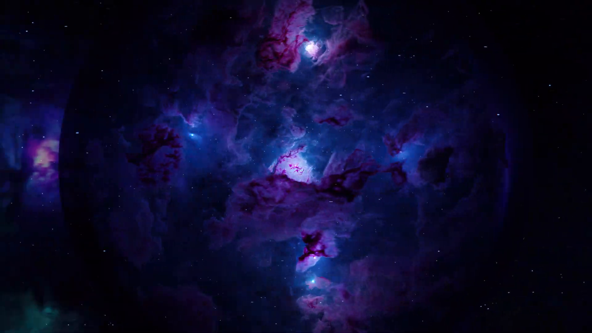
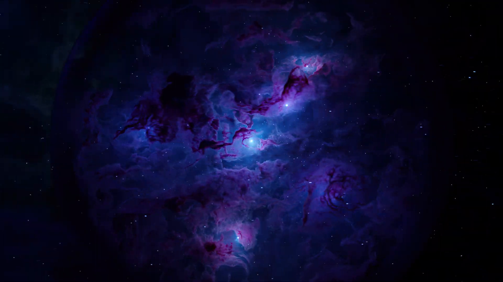

<div align="center">

# ✨ SPLATIFY

### *Reproduce, Discover, Innovate! From Papers and Ideas to Trainable 3DGS Code*

**✨ Turn any Gaussian Splatting paper — or a one-line idea — into trainable code. ✨**

[](https://arxiv.org/abs/2610.09116)
[](https://arxiv.org/pdf/2610.09116)
[](https://seemandhar.github.io/SPLATIFY/demo.html)
[-ff6b35?style=for-the-badge)](https://github.com/seemandhar/nerfify-code)

[](https://www.python.org/)
[](https://github.com/nerfstudio-project/gsplat)
[](https://docs.nerf.studio/)
[](https://docs.anthropic.com/en/docs/agents-and-tools/claude-agent-sdk)
[](LICENSE)
[](https://github.com/seemandhar/SPLATIFY/stargazers)

**[Seemandhar Jain](https://seemandhar.github.io/) · Keshav Gupta · [Manmohan Chandraker](https://cseweb.ucsd.edu/~mkchandraker/)**

*University of California, San Diego*

</div>

---

> 🚀 **3DGS papers → trainable gsplat / nerfstudio plugins, in minutes instead of weeks — then let agents improve on them.**

## Demo

▶ **[Interactive demo](https://seemandhar.github.io/SPLATIFY/demo.html)** — Act 1: an agent reads the original 3DGS paper and writes the `gs_template` implementation. Act 2: eight island agents compete across generations and discover **NebulaGS**, a physics-informed method for volumetric nebula scenes.

<p align="center">
  
  
  
  
</p>

## Overview

SPLATIFY is a multi-agent framework that converts 3D Gaussian Splatting research into complete, trainable [gsplat](https://github.com/nerfstudio-project/gsplat)-based [nerfstudio](https://docs.nerf.studio/) plugins. It has three modes:

| Mode | Entry point | What it does |
|---|---|---|
| **Reproduce** (paper → code) | `main.py` / Web UI `/` | Parse a paper (arXiv ID or PDF), plan it against the `gs_template` grammar, write the code, review, validate novelty coverage, smoke-test and debug — optionally train and check PSNR. |
| **Innovate** (tournament) | Web UI `/invent` | Eight island agents each take an improvement strategy (losses, densification, rendering, …) on a base method and compete over 2k → 7k → 30k-iteration elimination rounds. Also supports *scene → method*: describe a scene type and agents build a dedicated pipeline. |
| **Discover** (open-ended evolution) | Web UI `/discover` | Each generation trains 8 variants of the current best with accumulated cross-generation knowledge; the winner seeds the next generation until you stop it. |

All three generate code against **`gs_template`**, a grammar-constrained template that extends `SplatfactoModel` through 9 extension points (see [`CFG.md`](splatify/base-code/CFG.md)), and use the 30+ methods already implemented in it as in-context examples.

## Architecture (Reproduce)

```
Paper (arXiv ID / PDF)
  │
  ├─ [1] Parser ───── Download PDF → MinerU extraction → implementation-focused markdown
  ├─ [2] Planner ──── Map each contribution to gs_template extension points + file DAG
  ├─ [3] Coder ────── Generate the full method package (model, losses, rendering, configs…)
  ├─ [4] Reviewer ─── API compliance against SplatfactoModel / gsplat   (loop)
  ├─ [5] Validator ── Check every paper novelty & equation is implemented
  ├─ [6] Integrator ─ Cross-file consistency + MethodSpecification wiring
  ├─ [7] Tester ───── pip install → ns-install-cli → short ns-train smoke test
  └─ [8] Debugger ─── Diagnose & fix (gsplat / CUDA / nerfstudio), then optional
                      full training + PSNR review against dataset baselines
```

By default the Coder and Debugger run on Opus and the other agents on Sonnet (see `agents/definitions.py`).

### gs_template extension points

| # | Method | Override when |
|---|--------|---------------|
| 1 | `populate_modules()` | New per-Gaussian params, MLPs, state |
| 2 | `get_outputs()` | Custom rendering via gsplat rasterization |
| 3 | `compute_custom_losses()` | Novel loss terms |
| 4 | `split_gaussians()` | New params must follow densification |
| 5 | `get_gaussian_param_groups()` | Optimizers for new Gaussian params |
| 6 | `get_param_groups()` | Optimizers for non-Gaussian params |
| 7 | `get_outputs_for_camera()` | Viewer / eval outputs |
| 8 | `load_state_dict()` | Checkpoints with new params |
| 9 | `get_metrics_dict()` | Custom metrics |

## Prerequisites

- Linux + NVIDIA GPU, Python ≥ 3.10
- [nerfstudio](https://docs.nerf.studio/quickstart/installation.html) with CUDA PyTorch and `gsplat>=1.0`, in a conda env (default name `nerfstudio`)
- [Claude Code](https://docs.anthropic.com/en/docs/claude-code) / Claude Agent SDK with an Anthropic API key
- [MinerU](https://github.com/opendatalab/MinerU) for PDF extraction

## Setup

```bash
git clone https://github.com/seemandhar/SPLATIFY.git
cd SPLATIFY

# 1. Install the gs_template plugin (33 methods) into your nerfstudio env
conda activate nerfstudio
pip install -e splatify/base-code
ns-install-cli
ns-train --help | grep -E "gs-template|nebula-gs|fast-gs"   # sanity check

# 2. Install the agent pipeline (any Python ≥ 3.10 env)
pip install -r splatify/requirements.txt
export ANTHROPIC_API_KEY=sk-ant-...

# 3. Data: Mip-NeRF 360 (and optionally LLFF) under ./data, or point elsewhere
export SPLATIFY_DATA_ROOT=/path/to/data      # expects 360_v2/<scene>, nerf_llff_data/<scene>
```

| Environment variable | Default | Purpose |
|---|---|---|
| `ANTHROPIC_API_KEY` / `ANTHROPIC_AUTH_TOKEN` | — | Claude auth (OAuth token preferred if set) |
| `SPLATIFY_DATA_ROOT` | `./data` | Root containing `360_v2/` and `nerf_llff_data/` |
| `SPLATIFY_GS_TEMPLATE` | `splatify/base-code/gs_template` | Use a different gs_template checkout |
| `NERFSTUDIO_CONDA_ENV` | `nerfstudio` | Conda env used for install / training |
| `PORT` | `5007` | Web UI port |

## Usage

```bash
cd splatify

# Paper → code
python main.py --arxiv 2308.04079
python main.py --pdf /path/to/paper.pdf --method-name my_gs

# …with full training + PSNR review
python main.py --arxiv 2308.04079 --train --dataset mipnerf360 --scenes garden bicycle
python main.py --arxiv 2308.04079 --train --num-views 12          # few-shot

# Web UI (paper2code, /invent tournament, /discover evolution)
python web.py                                                   # http://localhost:5007
```

| Argument | Description | Default |
|---|---|---|
| `--arxiv` / `--pdf` | Paper source | — |
| `--method-name` | Override method package name (snake_case) | from plan |
| `--dataset` | `mipnerf360` or `llff` | `mipnerf360` |
| `--scenes` | Scenes for training / PSNR review | `garden` |
| `--data` | Custom dataset path | — |
| `--train` | Full training + PSNR review loop | off |
| `--max-iters` | Training iterations | `30000` |
| `--num-views` | Training views (`-1` = all; 3/6/9/12/24 for few-shot) | `-1` |
| `--no-review` / `--no-validation` / `--no-test` | Skip a stage | off |
| `--gs-template` | Path to a gs_template framework | bundled |

### Training & evaluating a bundled method directly

```bash
cd splatify/base-code
ns-train nebula-gs --data /path/to/scene colmap --eval-mode interval
python eval.py --gpu 0 --method fast-gs --scenes garden bicycle      # train + ns-eval → PSNR/SSIM/LPIPS
python read_tb.py outputs/garden/fast-gs/<timestamp>/                 # PSNR curve from TensorBoard
```

## Bundled methods (`gs_template`)

| `ns-train` name | Description |
|---|---|
| `gs-template` | Base template (≡ splatfacto) |
| `absgs` | AbsGS — absolute-gradient densification |
| `depth-reg-gs` | Depth-regularized GS (Pearson depth + opacity entropy) |
| `feature-gs` | Feature distillation into per-Gaussian latents |
| `micro-splatting` | Micro-Splatting — isotropy-informed covariance regularization |
| `compact-gs` | Compact 3DGS via gradient-driven natural selection |
| `msaa-gs`, `msaa-gs-plus` | MSAA-GS anti-aliasing (+ bilateral grid variant) |
| `opti3dgs` | Opti3DGS — coarse-to-fine frequency modulation |
| `decomp-gs` | Decomposing densification (G2L + C2F) |
| `bogauss` | BOGausS — better optimized GS |
| `light-gs` | LightGaussian compression |
| `stablegs` | StableGS — floater-free dual opacity + DUSt3R priors |
| `vod3dgs-s`, `vod3dgs-l` | VoD-3DGS view-dependent opacity |
| `rain-gs` | RAIN-GS — relaxed initialization |
| `trick-gs` | Trick-GS — bag of efficiency tricks |
| `clod-gs` | CLoD-GS — continuous level of detail |
| `twodgs` | 2D Gaussian Splatting |
| `pixel-gs` | Pixel-GS — pixel-aware gradient densification |
| `gaussian-shader` | GaussianShader — reflective shading |
| `scaffold-gs` | Scaffold-GS — anchor-based neural Gaussians |
| `dwtgs` | DWTGS — wavelet frequency regularization (sparse view) |
| `lp3dgs` | LP-3DGS — learning to prune |
| `compgs`, `compgs-enhanced` | CompGS vector quantization (+ agent-improved variant) |
| `cor-gs` | CoR-GS — sparse-view co-regularization |
| `fsgs` | FSGS — few-shot view synthesis |
| `fast-gs`, `fast-gs-big` | FastGS — 100-second training |
| `nebula-gs` | **NebulaGS** — physics-informed GS for volumetric nebulae (discovered by agents, see demo) |
| `bubble-gs` | **BubbleGS** — physics-informed thin-film interference for soap bubbles |
| `diamond-gs-3d` | **DiamondGS3D** — neural appearance GS for diamonds / gemstones |

## Project structure

```
SPLATIFY/
├── README.md
├── demo.html / nebula.mp4 / nebula-assets/   # Interactive demo (GitHub Pages)
└── splatify/
    ├── main.py              # Paper → code CLI (orchestrator)
    ├── web.py               # Flask UI: paper2code, /invent, /discover (SSE streaming)
    ├── invent.py            # 8-island tournament + scene → method
    ├── discover.py          # Open-ended generational discovery
    ├── config.py            # Pipeline config, dataset baselines, paths
    ├── agents/definitions.py# 8 subagent definitions + system prompts
    ├── templates/           # Web UI pages
    ├── CLAUDE.md            # Agent-facing project notes
    └── base-code/           # gs_template nerfstudio plugin
        ├── gs_template/
        │   ├── model.py         # GSTemplateModel (9 extension points)
        │   ├── rendering.py     # prepare_camera / rasterize_gaussians / assemble_outputs
        │   ├── losses.py        # 30+ reusable losses
        │   ├── datamanagers.py  # Depth / feature DataManagers
        │   ├── shading.py, optimizers.py, configs.py
        │   └── methods/         # 33 registered methods (in-context examples)
        ├── CFG.md           # Paper-to-code grammar
        ├── eval.py          # Train + ns-eval across scenes
        ├── read_tb.py       # PSNR curves from TensorBoard
        └── pyproject.toml   # nerfstudio entry points
```

Runs write intermediate files to `splatify/workspace/<run_id>/` and generated packages to `splatify/generated/<run_id>/<method>/` (an installable plugin with `pyproject.toml`; `pip install -e . && ns-install-cli && ns-train <method>`).

## Citation

```bibtex
@article{jain2026splatify,
  title   = {SPLATIFY: Reproduce, Discover, Innovate! From Papers and Ideas to Trainable 3DGS Code},
  author  = {Jain, Seemandhar and Gupta, Keshav and Chandraker, Manmohan},
  journal = {arXiv preprint arXiv:2610.09116},
  year    = {2026}
}
```

See also **[NERFIFY](https://github.com/seemandhar/nerfify-code)** (CVPR 2026 Highlight), the NeRF counterpart.

## Acknowledgements

Built on [nerfstudio](https://github.com/nerfstudio-project/nerfstudio), [gsplat](https://github.com/nerfstudio-project/gsplat) and the [Claude Agent SDK](https://docs.anthropic.com/en/docs/agents-and-tools/claude-agent-sdk). Bundled method reimplementations follow their original papers; please cite those works when using them.
